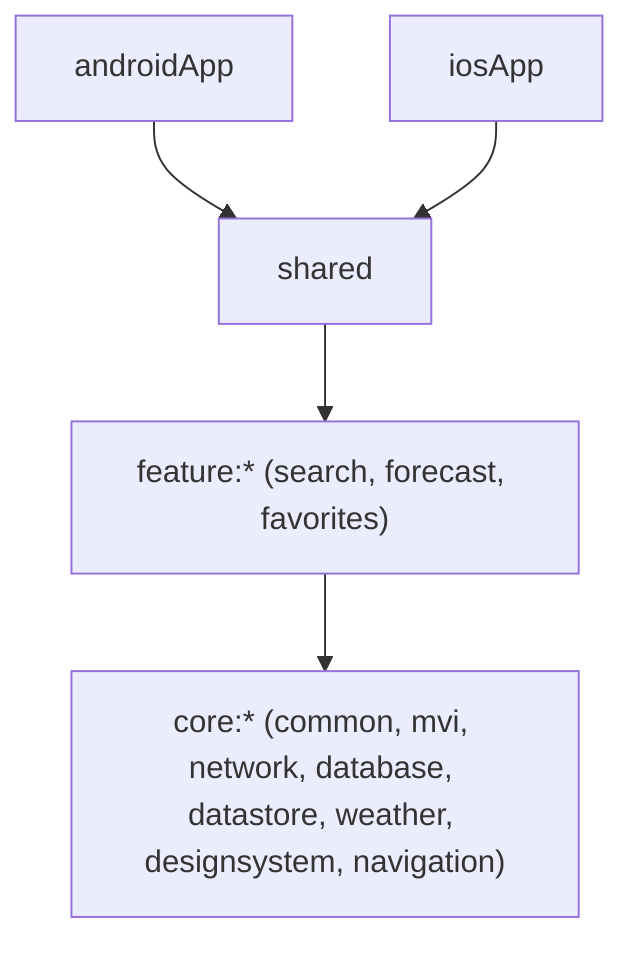

# 🌦️ NavyWeather

A weather app for **Android and iOS** built with **Kotlin Multiplatform** and **Compose Multiplatform**.

The project is a technical challenge on KMP architecture: the goal is not only a working app, but a codebase where every architectural and technical decision is justified, specified and tested.

---

## What the app does

| Feature | Description |
|---|---|
| **Favorite places** | Home screen with the places you saved and their current temperature |
| **City search** | Find any city by name, in your language |
| **Weather forecast** | Current conditions and the next 7 days, available offline |

Weather data comes from [Open-Meteo](https://open-meteo.com/) (free, no API key), so the project builds and runs without any secrets.

## Architecture at a glance



- **Feature-based multi-module**: one module per feature; a feature never depends on another feature.
- **Clean Architecture**: `domain`, `data` and `presentation` layers inside each feature, with boundaries enforced by architecture tests.
- **MVI** presentation: immutable state, sealed intents, a pure reducer and one-shot effects.
- **Offline-first** data: the local database is the single source of truth; the network only refreshes it.

## Tech stack

| Area | Choice |
|---|---|
| UI | Compose Multiplatform, Material 3 Expressive, Navigation Compose |
| Network | Ktor Client + kotlinx.serialization |
| Local data | Room KMP (bundled SQLite) + DataStore |
| Dependency injection | Koin |
| Tests | kotlin.test, coroutines-test, Turbine, Mokkery, Compose UI Test, Konsist |

The reasoning behind each choice, compared with its alternatives, is documented in [docs/tech-stack.md](docs/tech-stack.md). The module structure, layers and MVI contract are described in [docs/architecture.md](docs/architecture.md), and every architectural decision has its own record in [docs/adr](docs/adr/README.md).

## How this project is built

The project is **spec-driven**, using [OpenSpec](https://github.com/Fission-AI/OpenSpec):

1. Each phase starts as an **OpenSpec change** (`openspec/changes/`): proposal, spec deltas with `GIVEN / WHEN / THEN` scenarios, design and tasks.
2. The change is implemented in its own **pull request**, with tests running on the JVM and the iOS simulator.
3. Once verified, the change is archived and its requirements become part of the living specs in `openspec/specs/`.
4. Architectural decisions are recorded as **ADRs** in [`docs/adr/`](docs/adr/README.md), and each phase is documented in `docs/phases/`.

The workflow itself is described in [Phase 0](docs/phases/phase-0-spec-tooling.md).

## Getting started

Requirements: JDK 25, the Android SDK (platform 37) with `sdk.dir` in `local.properties`, and Xcode with an iOS simulator for iOS tests.

Run every shared test on the JVM and the iOS simulator:
```bash
./gradlew allTests
```

## Roadmap

| Phase | Scope | Status |
|---|---|---|
| 0. [Spec tooling](docs/phases/phase-0-spec-tooling.md) | OpenSpec setup, AI agent commands, ADR process | Done |
| 1. [Build foundation](docs/phases/phase-1-build-foundation.md) | Gradle setup, version catalog, convention plugins, base core modules, architecture docs | Done |
| 2. [Core infrastructure](docs/phases/phase-2-core-infrastructure.md) | Network, local database, preferences, shared weather data source, design system | Done |
| 3. Favorite places and app shell | Favorites feature end to end, Android and iOS apps, navigation and DI wiring | Planned |
| 4. Search and forecast | City search and the offline-first weather forecast | Planned |
| 5. Quality and documentation | Architecture tests, final documentation and AI usage report | Planned |

The requirements of the challenge (architecture, patterns, tech stack justification, AI usage and deliverables) are addressed across these phases and summarized in the documentation once complete.
