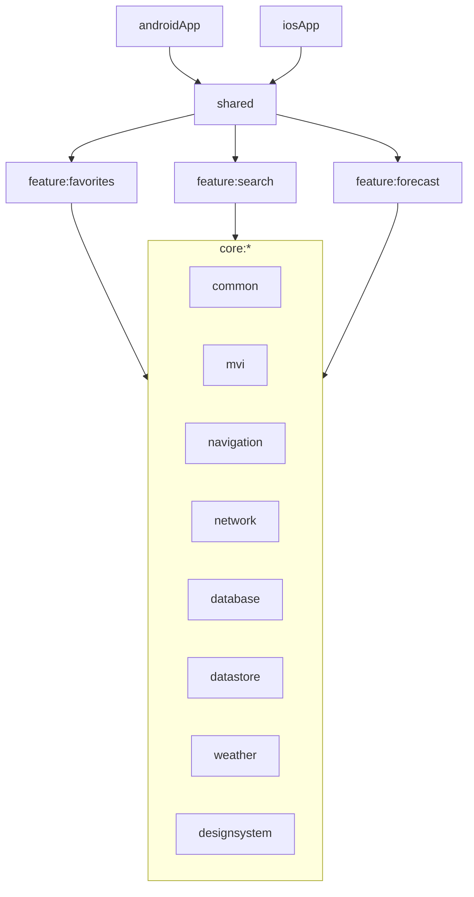
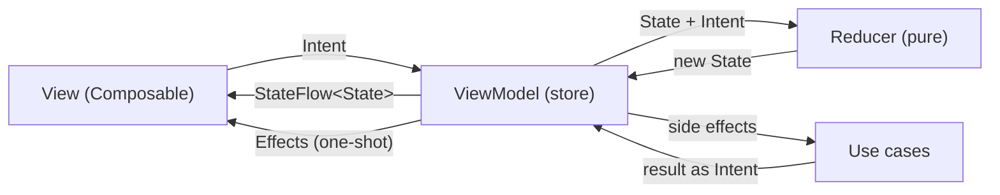

# Architecture

This document describes how NavyWeather is structured and why. Library choices are justified separately in [tech-stack.md](tech-stack.md), and each architectural decision has its own record in [docs/adr](adr/README.md).

## Module topology

```
NavyWeather/
├── build-logic/                ← Convention plugins (shared Gradle configuration)
├── gradle/libs.versions.toml   ← Version catalog
│
├── androidApp/                 ← Android entry point                         (Phase 3)
├── iosApp/                     ← Xcode project hosting the shared UI          (Phase 3)
├── shared/                     ← Composition root: NavHost, Koin graph, iOS framework (Phase 3)
│
├── core/
│   ├── common/                 ← AppResult/AppError, dispatchers, device language
│   ├── mvi/                    ← MVI contract: MviViewModel, Reducer, UiState/UiIntent/UiEffect
│   ├── navigation/             ← Typed route contracts shared by features
│   ├── testing/                ← Test helpers (virtual-time ViewModel tests)
│   ├── network/                ← Ktor client and error mapping                (Phase 2)
│   ├── database/               ← Room database, entities and DAOs             (Phase 2)
│   ├── datastore/              ← User preferences                             (Phase 2)
│   ├── weather/                ← Open-Meteo forecast download into the cache  (Phase 2)
│   └── designsystem/           ← Material 3 Expressive theme and shared states (Phase 2)
│
└── feature/
    ├── favorites/                                                             (Phase 3)
    ├── search/                                                                (Phase 4)
    └── forecast/                                                              (Phase 4)
```



### Dependency rules

- ✅ `app → shared → feature:* → core:*`
- ❌ A `feature:*` module never depends on another `feature:*` module. Features talk to each other only through the routes in `core:navigation` (navigation) or through shared core data (for example the same database table). Only `shared` knows every feature and builds the `NavHost`.
- ❌ A `core:*` module never depends on a `feature:*` module.
- When two features need the same behavior, it is extracted to a core module instead of creating a feature-to-feature dependency.

These rules are enforced by architecture tests in Phase 5.

## Targets

| Target | Purpose |
|---|---|
| `android` | Production. Uses AGP 9's `com.android.kotlin.multiplatform.library` plugin. |
| `iosArm64`, `iosSimulatorArm64` | Production: iOS devices and the Apple Silicon simulator. |
| `jvm` | **Not shipped.** A fast host for shared tests (database, Compose UI tests, DI graph verification) without an emulator ([ADR-0005](adr/0005-jvm-target-as-test-host.md)). |

## Convention plugins

Every module applies one plugin for its role and declares only its own dependencies ([ADR-0004](adr/0004-convention-plugins-in-build-logic.md)):

| Plugin | Used by | Adds |
|---|---|---|
| `navyweather.kmp.library` | Every shared module | Targets, Android namespace derived from the module path, coroutines, `kotlin.test`, coroutines-test |
| `navyweather.kmp.compose` | Modules with UI | Compose Multiplatform, Material 3, icons, Compose Resources |
| `navyweather.kmp.feature` | Feature modules | `core:common`, `core:mvi`, `core:designsystem`, `core:navigation`, Koin, Navigation Compose, serialization, Mokkery, Turbine, Compose UI test |
| `navyweather.room` | `core:database` | KSP + Room compiler for every target, bundled SQLite, schema export |

## Clean Architecture: packages, not submodules

Each feature keeps its layers as packages:

```
feature/forecast/src/commonMain/kotlin/com/navyblue/navyweather/feature/forecast/
├── domain/         ← Pure models, repository interfaces, use cases
├── data/           ← Repository implementations, DTOs, mappers, data sources
├── presentation/   ← Contract (State/Intent/Effect), reducer, ViewModel, screens
└── di/             ← The feature's Koin module
```

**Why not `:feature:forecast:domain` + `:data` + `:presentation`?** (full record: [ADR-0002](adr/0002-clean-architecture-layers-as-packages.md))

1. **In KMP every module costs several compilations.** Each one compiles for Android, iOS device, iOS simulator and the JVM test host, and links through Kotlin/Native. Per-layer submodules would roughly triple the number of feature modules for little gain.
2. **The real benefit of submodules is a compiler-enforced boundary** (domain cannot import data). The same guarantee comes from architecture tests that fail when `domain` imports `data`, `presentation`, Ktor or Room.
3. **It scales incrementally.** A feature that grows, or whose domain must be shared, can be split into submodules at that point. Going from packages to modules is cheap; undoing over-modularization is not.

**Exception:** Room needs every entity in one `@Database`, so entities and DAOs live in `core:database`. Features use them only from their `data` layer and map them to domain models.

## Patterns

| Pattern | Where | Purpose |
|---|---|---|
| Repository | Interface in `domain`, implementation in `data` | The domain does not know whether data comes from the network or the cache. |
| Use case | `domain` | One business action per class (`operator fun invoke`). The only way presentation reaches the domain; business rules live here. |
| MVI | `presentation` | See below. |
| Mapper | `data` | DTO → domain and entity ↔ domain, so transport and storage models never leak. |
| Offline-first / single source of truth | Repositories | The database is what the UI observes; the network only refreshes it. |

## Presentation: MVI



| Piece | Responsibility |
|---|---|
| **State** | Immutable `data class` with everything the screen renders. |
| **Intent** | `sealed interface` with every user action and every background result. |
| **Reducer** | Pure `(State, Intent) -> State`. No coroutines, I/O or dependencies. |
| **Effect** | One-shot events that are not state: navigation, snackbars. Delivered once. |
| **ViewModel** | `MviViewModel` applies the reducer, then runs side effects (use cases), exposing `StateFlow<State>` and `Flow<Effect>`. |

`onIntent` updates the state through the reducer **before** calling `handleIntent`, so side effects always see the new state. Effects use a buffered channel: each one is delivered once and never replayed to a recreated UI. `CollectEffects` collects them only while the screen is at least STARTED.

### Why MVI and not MVVM

Recorded in [ADR-0003](adr/0003-in-house-mvi-contract.md).


| Criterion | MVVM | MVI ✅ |
|---|---|---|
| Source of truth | Often several loose `StateFlow`s that can drift out of sync | One immutable state: impossible combinations cannot be represented |
| Inputs | Many public methods | One entry point, `onIntent`, with an exhaustive `sealed` set of intents |
| Transition logic | Spread across methods, mixed with coroutines | Concentrated in a pure reducer, tested without coroutines or mocks |
| Debugging | Hard to reconstruct how a state was reached | Every change is `Intent → State`; an intent log reproduces a bug |
| One-shot events | No standard pattern | A dedicated `Effect` channel |
| Cost | Less boilerplate | More boilerplate, reduced by the shared `core:mvi` contract |

### Library or in-house contract?

The contract is about 50 lines in `core:mvi`, built on the multiplatform androidx `ViewModel` (which Koin integrates with through `koinViewModel()`).

- **Orbit MVI**: multiplatform and mature, but adds its own DSL for something that fits in one class.
- **MVIKotlin**: very complete (stores, time travel), but designed around Decompose and heavier than needed.

## Error model

Operations that can fail return `AppResult<T>` (`Success` or `Failure`) instead of throwing. `AppError` is a closed set: `Network`, `Http(code)`, `Serialization` and `Unknown(message)`. The network layer (Phase 2) maps library exceptions into it, and the design system turns each kind into a localized message.

## Navigation contracts

Routes are `@Serializable` types in `core:navigation`: `FavoritesRoute`, `SearchRoute` and `ForecastRoute(cityId, name, country, latitude, longitude)`. Arguments are primitives, so no feature exposes its domain models to others.
