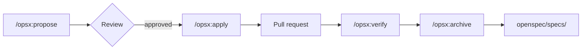

# Phase 0 — Spec tooling

**OpenSpec change:** none (this phase installs the tooling that every later change uses)
**ADRs:** [0001 Spec-driven development with OpenSpec](../adr/0001-spec-driven-development-with-openspec.md)

## Goal

Set up the workflow before any code exists: how a phase is proposed, implemented, verified and archived, and where decisions are recorded.

## What this phase delivers

| Area | Delivered |
|---|---|
| OpenSpec | `openspec/config.yaml` with the project context and the rules for proposals, specs, design and tasks; empty `openspec/specs/` and `openspec/changes/archive/` |
| AI agent integration | `/opsx:*` commands and `openspec-*` skills for Claude Code in `.claude/` |
| Decision records | `docs/adr/` with the ADR template, the index and ADR-0001 |
| Docs | This document and the README workflow section |

## The workflow



1. **Propose.** `/opsx:propose` creates `openspec/changes/<change>/` with `proposal.md` (why and scope), spec deltas (`SHALL` requirements with `GIVEN / WHEN / THEN` scenarios), `design.md` (how, linking ADRs) and `tasks.md` (checkboxes). The proposal is reviewed before any code is written and committed on its own (`spec: ...`).
2. **Apply.** `/opsx:apply` implements the tasks one by one, each with the test that verifies it, on the phase branch (`feat: ...`).
3. **Verify.** `/opsx:verify` checks the implementation against the change: every task done, every requirement covered, tests passing on the JVM and the iOS simulator.
4. **Archive.** `/opsx:archive` merges the spec deltas into `openspec/specs/` and moves the change to `openspec/changes/archive/`, so the main specs always describe the current behavior.

## Specs and ADRs

Specs say **what** the system must do; ADRs say **why** a decision was made. A change that introduces an architectural or technology decision adds its ADR in the same pull request, and its `design.md` links to it. See [docs/adr](../adr/README.md).

## Why there is no OpenSpec change for this phase

A change needs the OpenSpec project (its context, rules and schema) to exist first. This phase creates that project, so it is documented here and in ADR-0001 instead.

## Prerequisites

- [OpenSpec CLI](https://github.com/Fission-AI/OpenSpec) 1.14 or newer (`npm install -g @fission-ai/openspec`).
- Claude Code, to use the `/opsx:*` commands (the CLI works on its own as well).

## Commands

List changes and specs:
```bash
openspec list
```

Validate every change strictly:
```bash
openspec validate --changes --strict
```
